<h1 align="center">
  
   
  SharpIDE
</h1>

A modern, cross platform & open source IDE for .NET

### Building
See [CONTRIBUTING.md](CONTRIBUTING.md) for instructions for building and running SharpIDE locally!

### WIP
SharpIDE is a WIP, and contributions are always welcome! If you encounter an error, please raise an issue! 😊

### FAQs

SharpIDE won't open on MacOS Tahoe

Tahoe further restricted users' ability to run unsigned software. Follow these steps to get it running:

1. download a fresh zip of the latest release
2. extract
3. move SharpIDE.app to `Applications`
4. open terminal
5. run `xattr -d -r com.apple.quarantine /Applications/SharpIDE.app`
6. run `sudo codesign --force --deep --sign - /Applications/SharpIDE.app`

if codesign is not installed, install it with `xcode-select --install`

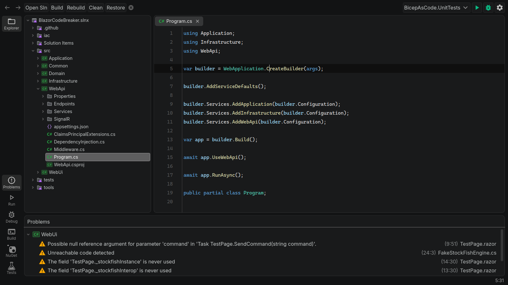

## Completions
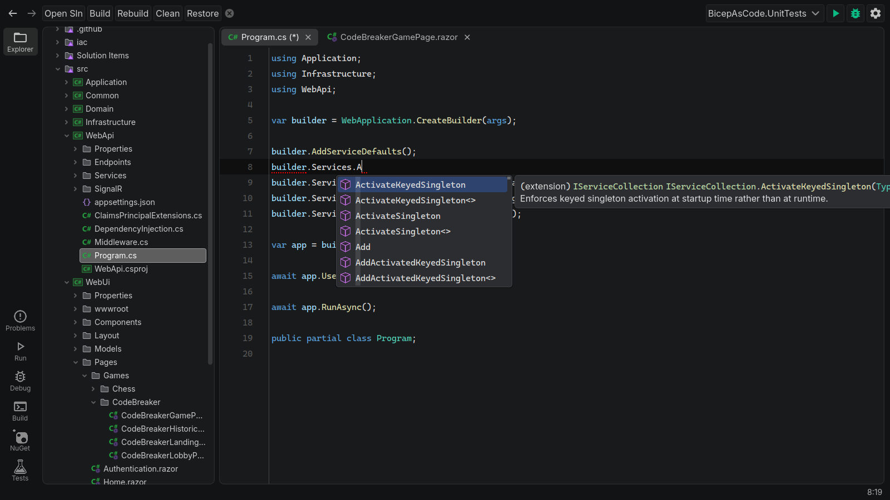

## Signature Help
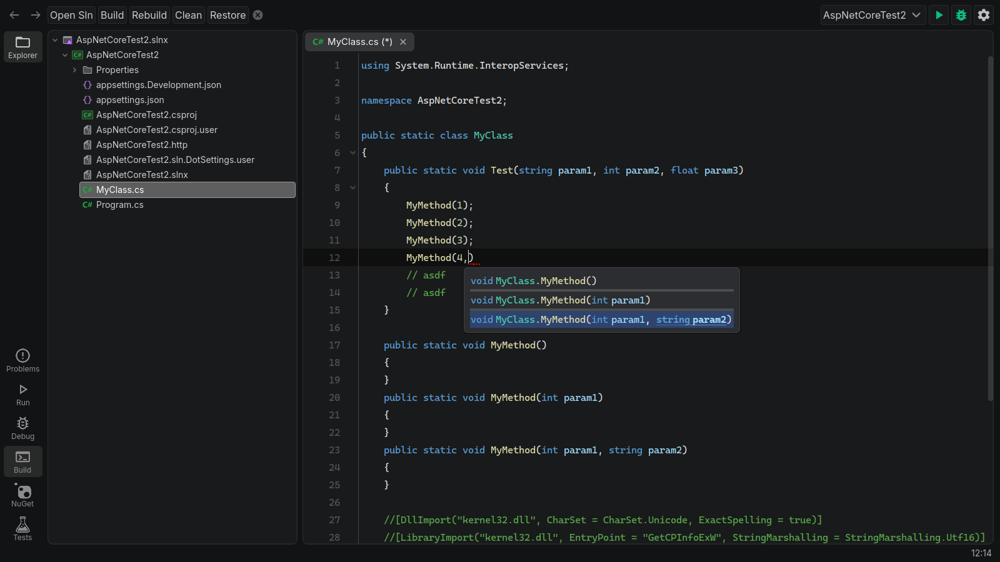

## Code Action/Refactoring
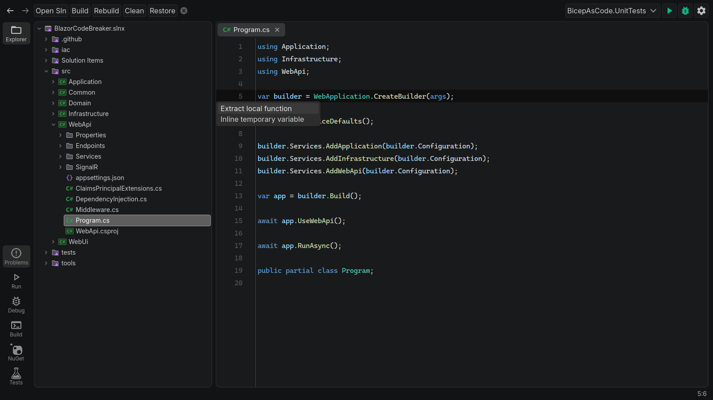

## Symbol Info
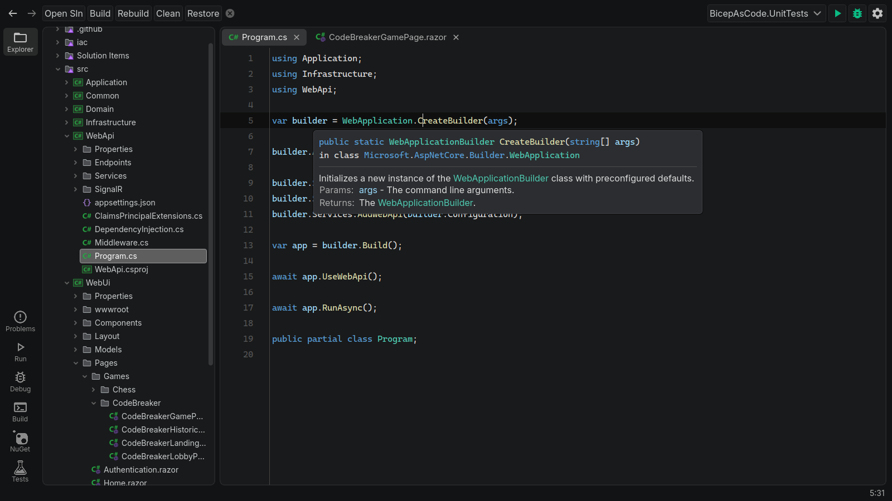

## Razor Syntax Highlighting
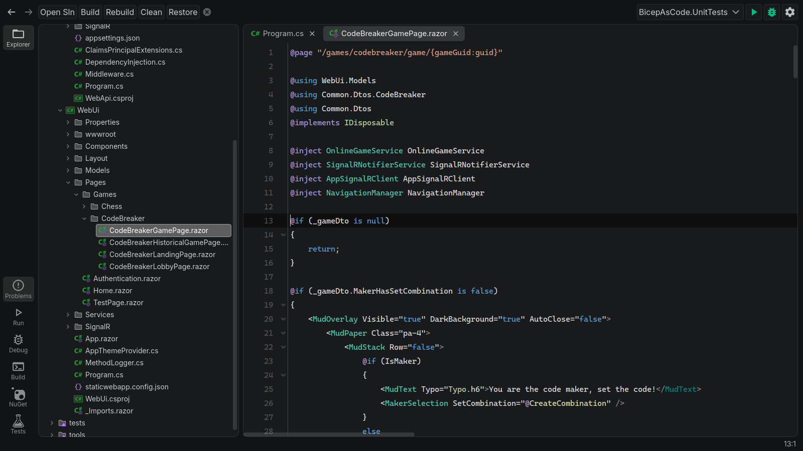

## Run
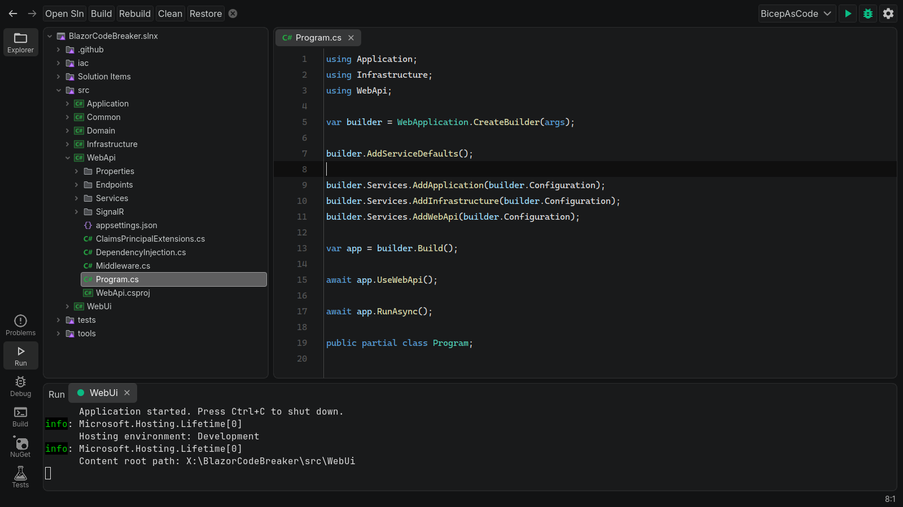

## Debug
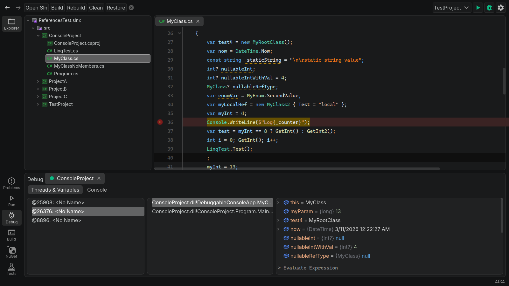

## Build
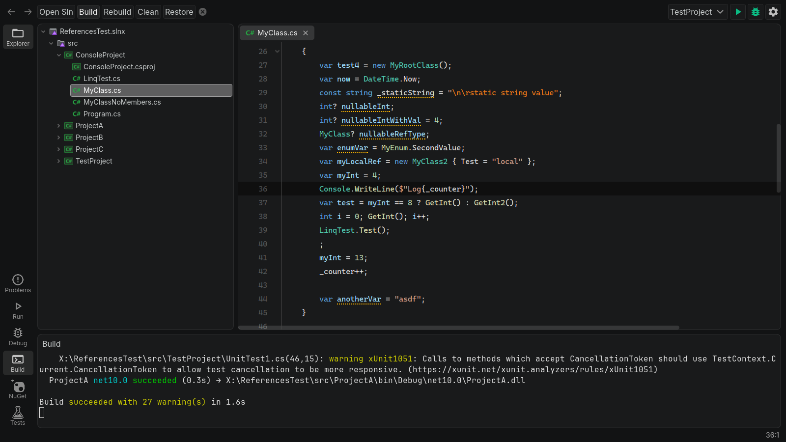

## NuGet (WIP)
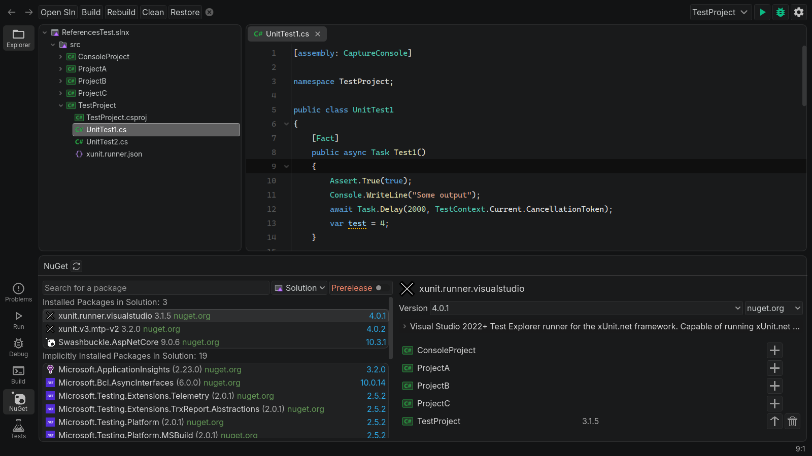

## Test Explorer (WIP)
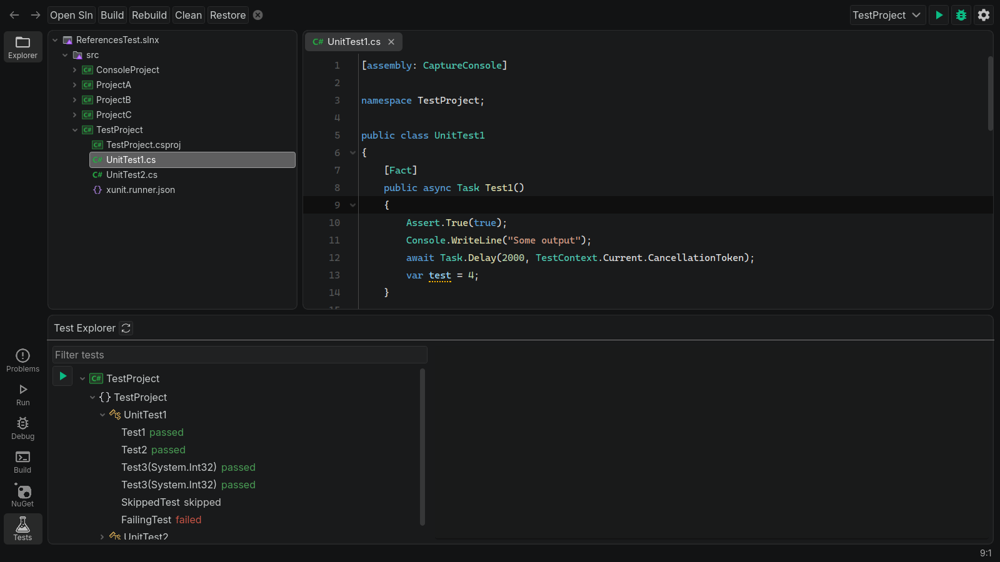

## Solution Picker
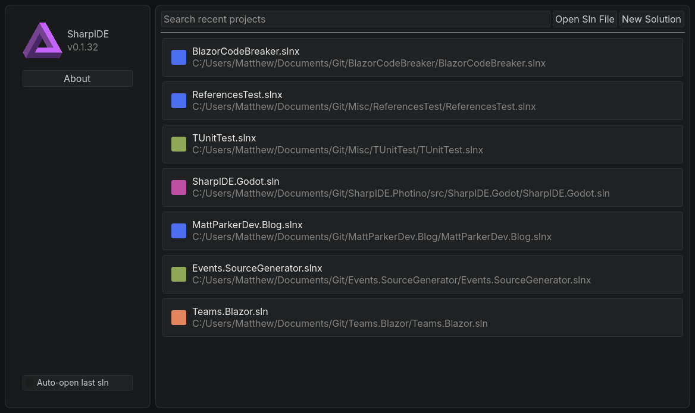
